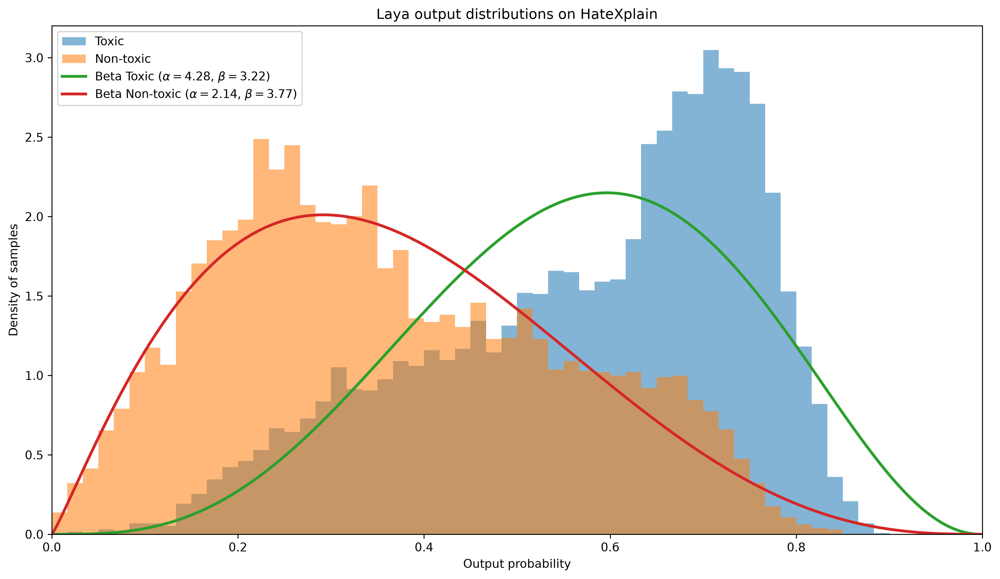
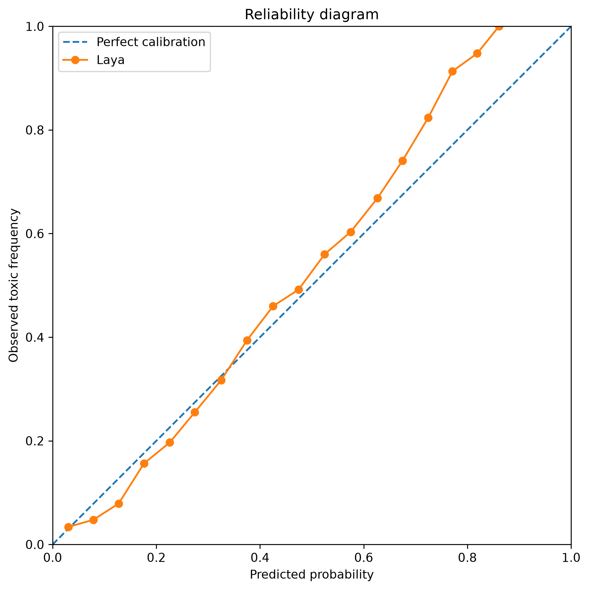
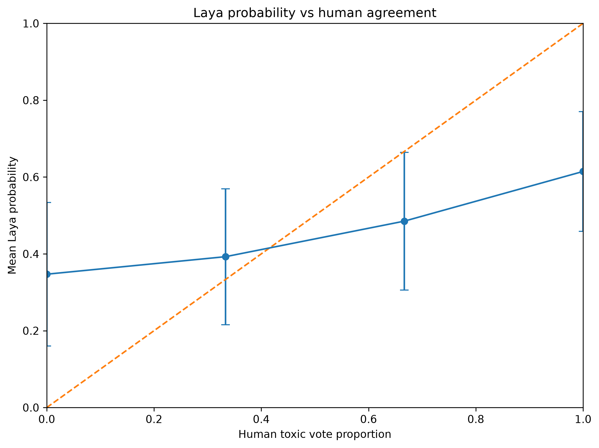

# Laya × HateXplain: Beta-Distribution Analysis of Probabilistic Binary Decisions

This repository contains a reproducible experiment testing whether the class-conditional output probabilities of a binary probabilistic decision model can be approximated by **Beta distributions**, and whether those fitted distributions preserve useful information about model performance.

The experiment is inspired by Niccolò Manfredi Selvaggi's 2022 Master's thesis, *A new metric for the interpretability of artificial neural networks in medical diagnosis applications*. The thesis studies binary classifiers whose output distributions can, under specific assumptions, be modeled by Beta distributions and mapped to **Subjective Logic**.

Here, the same idea is tested on a difficult semantic classification task using:

- **Laya** as the binary probabilistic decision model;
- **HateXplain** as the human-annotated dataset;
- a binary **toxic / non-toxic** task;
- a **balanced 50/50 evaluation set**;
- Beta fitting;
- calibration analysis;
- reconstruction of classical metrics;
- comparison with human annotator agreement;
- Subjective Logic mapping.

---

## Research question

The main question is:

> Can the full output distribution of a probabilistic binary classifier be compressed into two Beta distributions while preserving meaningful information about classification performance and uncertainty?

The experiment specifically tests whether:

1. the output probabilities for the two true classes have a Beta-like structure;
2. the fitted Beta distributions reconstruct classical metrics such as accuracy and ROC AUC;
3. the probabilistic outputs are reasonably calibrated;
4. Laya probabilities correlate with human annotator agreement;
5. the fitted Beta parameters can be mapped into Subjective Logic opinions.

---

## Why a difficult binary task?

The original thesis focuses on binary classification settings in which the task is not trivially separable.

If a classifier reaches near-perfect accuracy, outputs tend to collapse toward 0 and 1 and the additional probabilistic structure becomes less informative.

HateXplain is useful because toxicity classification is:

- binary after preprocessing;
- semantically difficult;
- partly subjective;
- annotated by multiple humans;
- far from perfectly separable.

This puts the experiment in a regime that is conceptually close to the use case studied in the thesis.

---

## Dataset

The experiment uses **HateXplain**.

Original labels:

- `hatespeech`
- `offensive`
- `normal`

Binary conversion:

```text
hatespeech -> toxic
offensive  -> toxic
normal     -> non-toxic
```

For each post, the preprocessing retains:

- text;
- individual annotator labels;
- majority-vote binary ground truth;
- number of toxic votes;
- total number of votes;
- proportion of annotators voting toxic.

---

## Balanced evaluation set

To match the balanced-class assumption used in part of the thesis derivation, the final evaluation set is constructed with:

```text
7,814 toxic
7,814 non-toxic
15,628 total
```

Therefore:

```text
P(Toxic) = 0.5
P(Non-toxic) = 0.5
```

The balanced dataset is created **after Laya inference**, so no additional model calls are required.

This balanced dataset is the main dataset used for the results reported below.

---

## Laya task

Every HateXplain post is evaluated with the same binary Noul question.

Conceptually:

```text
State:
Social media post:
<POST TEXT>

Question:
Is the text toxic, hateful, or offensive?

TRUE:
The text is toxic, hateful, or offensive.

FALSE:
The text is normal and is not toxic, hateful, or offensive.
```

For every post, Laya returns:

```text
p = P(Toxic | text)
```

The hard classification threshold used for standard metrics is:

```text
p >= 0.5 -> toxic
p <  0.5 -> non-toxic
```

---

## Experimental pipeline

```text
HateXplain
    |
    v
Binary toxic / non-toxic labels
    |
    v
Laya Noul inference
    |
    v
P(Toxic) for every post
    |
    v
Balanced 50/50 evaluation set
    |
    +-------------------------------+
    |                               |
    v                               v
Empirical metrics              Human agreement
    |                               |
    v                               v
Calibration                  Correlation analysis
    |
    v
Split by true class
    |
    +-----------------------------+
    |                             |
    v                             v
Toxic outputs                 Non-toxic outputs
    |                             |
    v                             v
Beta(alpha_T, beta_T)         Beta(alpha_N, beta_N)
    |                             |
    +-------------+---------------+
                  |
                  v
      Reconstruct classical metrics
                  |
                  v
          Subjective Logic
```

---

## Empirical performance

On the balanced dataset:

| Metric | Value |
|---|---:|
| Accuracy | 0.718070 |
| Precision | 0.730894 |
| Recall | 0.690299 |
| Specificity | 0.745841 |
| ROC AUC | 0.795082 |
| Brier score | 0.188014 |
| Log loss | 0.557734 |
| Calibration error | 0.045640 |

The model is clearly better than random while remaining far from perfect.

This is the intended regime for the experiment: a difficult binary classification problem with substantial overlap between the class-conditional probability distributions.

---

## Beta fitting

For each true class, the empirical distribution of Laya output probabilities is fitted with a Beta distribution:

```math
f(p; \alpha,\beta)
=
\frac{1}{B(\alpha,\beta)}
p^{\alpha-1}(1-p)^{\beta-1}
```

### Toxic class

```text
alpha = 4.281444
beta  = 3.221464
```

Empirical mean:

```text
0.575602
```

Beta mean:

```text
0.570638
```

### Non-toxic class

```text
alpha = 2.139915
beta  = 3.767831
```

Empirical mean:

```text
0.362789
```

Beta mean:

```text
0.362222
```

The fitted distributions reproduce the empirical class-conditional means closely.

---

## Output distributions



The two distributions overlap strongly, but their centers are clearly separated:

- toxic examples tend toward higher `P(Toxic)`;
- non-toxic examples tend toward lower `P(Toxic)`.

This is consistent with a difficult but meaningful binary classifier.

---

## Beta fit quality

| Class | KS statistic | KS p-value | KL fitting error |
|---|---:|---:|---:|
| Toxic | 0.095627 | 1.21e-62 | 0.094593 |
| Non-toxic | 0.025927 | 5.38e-05 | 0.024775 |

The Beta approximation is substantially better for the non-toxic class.

With thousands of observations, the KS test is sensitive to small systematic deviations, so the fitted distributions should **not** be described as exact Beta distributions.

A more appropriate interpretation is:

> Beta distributions provide a low-dimensional approximation of the class-conditional output distributions.

The KL fitting errors support the same conclusion: the approximation is particularly close for the non-toxic distribution and less exact for the toxic distribution.

---

## Reconstruction of classical metrics from the Beta distributions

A central test of the thesis-inspired approach is whether the four fitted Beta shape parameters retain enough information to reconstruct standard performance metrics.

| Metric | Empirical | Beta reconstruction | Absolute error |
|---|---:|---:|---:|
| Accuracy | 0.718070 | 0.712536 | **0.005534** |
| ROC AUC | 0.795082 | 0.794312 | **0.000770** |
| Recall | 0.690299 | 0.659150 | 0.031149 |
| Specificity | 0.745841 | 0.765922 | 0.020081 |

This is the strongest result of the experiment.

The entire set of 15,628 probabilistic outputs is compressed into only four fitted parameters:

```text
alpha_Toxic
beta_Toxic
alpha_NonToxic
beta_NonToxic
```

Yet the reconstructed ROC AUC differs from the empirical ROC AUC by only:

```text
0.000770
```

and the reconstructed accuracy differs by:

```text
0.005534
```

The Beta approximation is therefore imperfect as a distributional model but highly effective at preserving performance-relevant information.

---

## Calibration



The reliability diagram compares:

```text
predicted probability
```

with:

```text
observed toxic frequency
```

Perfect calibration would lie on the diagonal.

On the balanced dataset, the curve tracks the diagonal relatively closely over a substantial part of the probability range, with increasing deviation at higher predicted probabilities.

The measured calibration error is:

```text
0.045640
```

This is markedly lower than the value obtained on the natural imbalanced class distribution and shows why respecting the balanced-class setting matters when comparing the experiment with the theoretical assumptions used in the thesis.

---

## Human annotator agreement

HateXplain contains multiple annotations for each example.

For each post:

```text
human_toxic_probability
=
toxic votes / total annotator votes
```

The observed association between Laya probability and human toxic-vote proportion is:

| Statistic | Value |
|---|---:|
| Pearson r | 0.545408 |
| Spearman rho | 0.544458 |

Both correlations are highly statistically significant.



The relationship is monotonic:

- unanimous non-toxic cases receive lower Laya probabilities on average;
- unanimous toxic cases receive higher probabilities;
- mixed-vote examples lie between those extremes.

However:

```text
Laya probability != human vote proportion
```

The result supports an association between model confidence and human agreement, not equivalence between the two quantities.

---

## Subjective Logic mapping

Following the mapping used in the thesis:

```math
b = \frac{2\alpha - 1}{2\alpha + 2\beta}
```

```math
d = \frac{2\beta - 1}{2\alpha + 2\beta}
```

```math
u = \frac{1}{\alpha + \beta}
```

with:

```math
b + d + u = 1
```

### Toxic distribution

| Quantity | Value |
|---|---:|
| Belief | 0.503997 |
| Disbelief | 0.362721 |
| Uncertainty | 0.133282 |
| Proper opinion | True |

### Non-toxic distribution

| Quantity | Value |
|---|---:|
| Belief | 0.277587 |
| Disbelief | 0.553143 |
| Uncertainty | 0.169269 |
| Proper opinion | True |

Both mappings remain inside the proper Subjective Logic opinion space.

---

## Orientation of the non-toxic opinion

Laya always outputs:

```text
p = P(Toxic)
```

Therefore the raw non-toxic distribution is expressed in the toxic-probability coordinate.

If belief is intended to represent support for the **correct class**, non-toxic samples should instead use:

```text
q = 1 - p
```

For a Beta distribution, this corresponds to:

```text
Beta(alpha, beta) -> Beta(beta, alpha)
```

Thus the class-oriented non-toxic opinion has approximately:

```text
belief      = 0.553143
disbelief   = 0.277587
uncertainty = 0.169269
```

The uncertainty is unchanged.

---

## Main findings

The balanced experiment supports the following observations:

1. **Laya performs meaningfully on a difficult binary semantic task.**

   ```text
   Accuracy = 0.7181
   ROC AUC  = 0.7951
   ```

2. **The class-conditional outputs have a strong Beta-like structure**, although neither distribution is exactly Beta-distributed.

3. **Four Beta parameters preserve classical performance information extremely well.**

4. **ROC AUC reconstruction is especially accurate.**

   ```text
   Empirical ROC AUC = 0.795082
   Beta ROC AUC      = 0.794312
   Absolute error    = 0.000770
   ```

5. **Accuracy is also reconstructed closely.**

   ```text
   Empirical accuracy = 0.718070
   Beta accuracy      = 0.712536
   Absolute error     = 0.005534
   ```

6. **Calibration is reasonably good in the balanced setting.**

   ```text
   Calibration error = 0.045640
   ```

7. **Laya probability correlates with human annotator agreement.**

   ```text
   Pearson r  = 0.545408
   Spearman ρ = 0.544458
   ```

8. **The fitted distributions map to proper Subjective Logic opinions.**

---

## What the experiment does not prove

The experiment does **not** establish that:

- model outputs are universally Beta-distributed;
- the Beta family is the unique or theoretically necessary family;
- the mechanism producing the Beta-like shape is the same as that discussed in the original thesis;
- Laya's Noul probability is mathematically equivalent to the softmax probability studied in the thesis;
- Subjective Logic uncertainty is already validated as a direct measure of human disagreement;
- the observed results generalize to arbitrary semantic classification tasks.

The correct conclusion is narrower:

> On a difficult, balanced binary toxicity-classification task, Laya's class-conditional probabilistic outputs are well summarized by Beta distributions, and those approximations preserve several classical performance metrics with low error.

---

## Why the result is interesting

The most important aspect is not that the Beta fits are exact — they are not.

Instead, the result shows that:

```text
15,628 model outputs
```

can be reduced to:

```text
4 Beta shape parameters
```

while retaining an extremely accurate estimate of ROC AUC and a close estimate of accuracy.

This suggests that the Beta representation may function as a useful **low-dimensional probabilistic summary of classifier behavior** in difficult binary tasks.

---

## Repository structure

```text
.
├── README.md
├── prepare_hatexplain.py
├── run_laya_full.py
├── make_balanced_results.py
├── analyze_full_pipeline.py
│
├── data/
│   ├── hatexplain_dataset.json
│   └── hatexplain_full.csv
│
└── results/
    ├── hatexplain_full_laya_results.csv
    ├── hatexplain_full_laya_raw.jsonl
    ├── hatexplain_balanced_laya_results.csv
    │
    └── balanced_analysis/
        ├── summary.txt
        ├── metrics.csv
        ├── calibration_bins.csv
        ├── beta_fit_thesis_style.png
        ├── reliability_diagram.png
        └── human_agreement_vs_laya.png
```

---

## Reproducing the experiment

### 1. Install dependencies

```bash
pip install laya pandas numpy scipy matplotlib scikit-learn
```

### 2. Prepare HateXplain

```bash
python prepare_hatexplain.py
```

This creates:

```text
data/hatexplain_full.csv
```

### 3. Run Laya inference

```bash
python run_laya_full.py
```

Results are stored incrementally so interrupted runs can be resumed without repeating completed inference.

### 4. Create the balanced evaluation set

```bash
python make_balanced_results.py
```

This creates:

```text
results/hatexplain_balanced_laya_results.csv
```

with:

```text
7,814 toxic
7,814 non-toxic
15,628 total
```

### 5. Analyze the balanced dataset

Configure:

```python
RESULTS_PATH = (
    BASE_DIR
    / "results"
    / "hatexplain_balanced_laya_results.csv"
)

OUTPUT_DIR = (
    BASE_DIR
    / "results"
    / "balanced_analysis"
)
```

and run:

```bash
python analyze_full_pipeline.py
```

---

## Reproducibility requirements

To reproduce the experiment faithfully:

- use the same binary label conversion;
- keep the Noul question unchanged;
- keep the same Laya checkpoint/model version;
- retain raw Laya responses;
- use a fixed random seed for toxic-class downsampling;
- preserve the 50/50 class balance;
- use threshold `0.5` for the threshold-based classical metrics;
- record package and model versions;
- do not overwrite the full-dataset outputs when creating the balanced subset.

---

## Limitations

The main limitations are:

- HateXplain is one specific toxicity dataset.
- The binary conversion merges `hatespeech` and `offensive`.
- Human toxicity judgments are subjective and culturally dependent.
- The fitted Beta distributions are approximations, not exact generative models.
- The toxic distribution departs more strongly from the fitted Beta than the non-toxic distribution.
- Goodness-of-fit tests become highly sensitive with large sample sizes.
- Only one decision model is currently tested.
- The experiment does not identify the theoretical mechanism responsible for the Beta-like output shape.
- The current Subjective Logic mapping is global to each class distribution rather than an uncertainty estimate for an individual sample.

---

## Next research steps

The most useful extensions are:

1. reproduce the exact calibration measure defined in the original thesis;
2. compare the balanced and natural-prior analyses formally;
3. quantify where the toxic distribution deviates from the fitted Beta;
4. test whether Subjective Logic uncertainty predicts human disagreement;
5. repeat the experiment on a second difficult binary dataset;
6. compare Laya with another probabilistic classifier;
7. repeat the same protocol using Jev;
8. investigate whether Beta-like behavior is architecture-independent;
9. study whether the quality of the Beta approximation varies systematically with task difficulty.

---

## Safety note

HateXplain contains real hateful and offensive language.

Raw dataset files, model inputs, and stored responses may therefore contain explicit harmful content.

Use appropriate care when displaying, sharing, or publishing raw examples.

---

## Status

```text
[x] HateXplain preprocessing
[x] Binary toxic / non-toxic conversion
[x] Full-dataset Laya inference
[x] Balanced 50/50 evaluation subset
[x] Beta fitting
[x] Classical metric reconstruction
[x] Calibration analysis
[x] Human-agreement comparison
[x] Subjective Logic mapping
[ ] Exact thesis-specific calibration implementation
[ ] Cross-dataset replication
[ ] Jev replication
```

---

## Summary

On a balanced subset of HateXplain containing:

```text
15,628 samples
7,814 toxic
7,814 non-toxic
```

Laya achieves:

```text
Accuracy = 0.718070
ROC AUC  = 0.795082
```

The fitted class-conditional Beta distributions are:

```text
Toxic:
Beta(4.281444, 3.221464)

Non-toxic:
Beta(2.139915, 3.767831)
```

Using only these fitted distributions, the reconstructed ROC AUC is:

```text
0.794312
```

with an absolute error of:

```text
0.000770
```

and reconstructed accuracy is:

```text
0.712536
```

with an absolute error of:

```text
0.005534
```

These results provide evidence that a Beta-based representation can act as a compact and informative approximation of class-conditional probabilistic outputs on a difficult, balanced binary semantic classification task.
